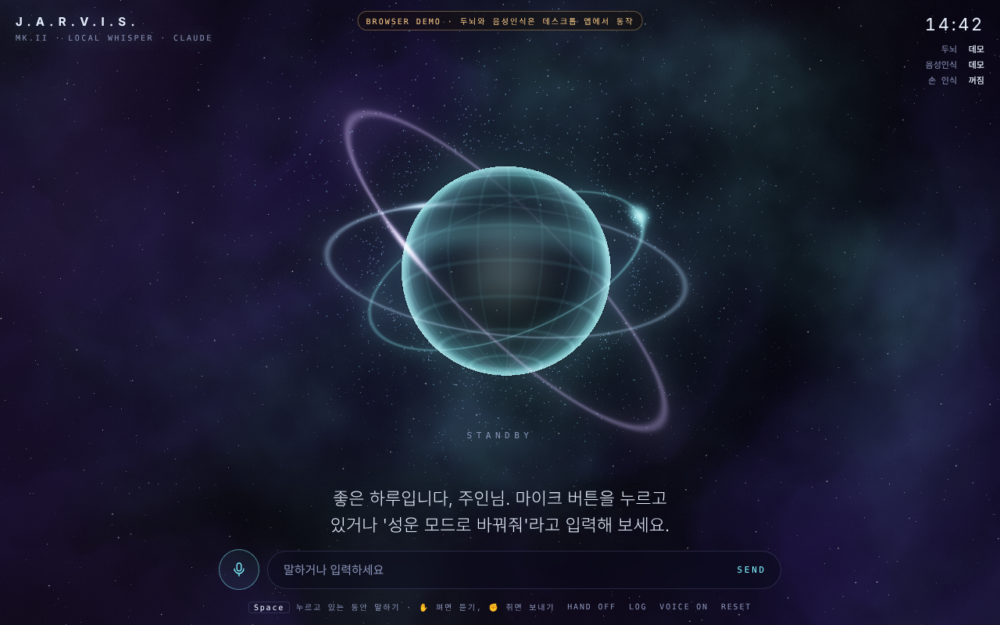

# J.A.R.V.I.S.

아이언맨 자비스를 목표로 하는 AI 비서. Rust(Tauri) + 로컬 Whisper 음성인식 + Groq(무료). 전부 무료로 돌릴 수 있습니다.
같은 화면(`ui/index.html`)이 **데스크톱 앱**과 **웹 버전** 양쪽에서 돌아갑니다.



## MK.III 새 기능

| 기능 | 웹 버전 | 데스크톱 앱 |
|---|---|---|
| **목소리 (무료)** | [Supertonic 3](https://github.com/supertone-inc/supertonic)를 브라우저에서 직접 실행 (ONNX Runtime, WebGPU 또는 CPU). 처음 한 번 받아 저장, 이후 오프라인. 받는 동안은 브라우저 기본 음성 | 같은 화면이라 동일 |
| **기록 네트워크** | "~ 기록해줘" → `remember` 도구가 제목·내용·주제 태그·관련 기록을 저장하고, MEMORY 화면에 별자리처럼 이어져 바로 뜸. 별을 누르면 내용, 드래그로 이동, 검색, 삭제 | 문서/Jarvis/memory.json에 저장 |
| **파일 만들기** | `create_file` → 다운로드 폴더에 저장 + "다시 받기" 링크 | 문서/Jarvis 폴더 안에만 만들고 바로 열기 (폴더 밖·실행 파일 차단) |
| **웹 열기** | 말을 마친 직후면 새 탭으로 바로 열고, 브라우저가 막으면 링크로 표시 | 기본 브라우저로 열기 |
| **파일 첨부** | 클립 버튼·끌어다 놓기·붙여넣기로 최대 5개(25MB). 글·코드·CSV·PDF·Word는 내용을 읽어 미리보기만 보내고 자비스가 `read_file`로 나눠 읽음, 이미지는 Groq 비전 모델(qwen3.8-27b)이 먼저 보고 설명, 음성 파일은 Groq Whisper로 받아쓰기 | 글 파일은 앞부분 6,000자를 함께 보냄 (이미지·음성은 웹 버전에서) |
| **파일 위성** | 첨부한 파일이 브라우저(IndexedDB)에 최근 24개까지 남고, 최근 12개가 종류별 색의 위성으로 구체 주위를 돎. 누르거나 "아까 올린 PDF 다시 보여줘"라고 하면 뷰어(원본·글 내용·다시 첨부·삭제)가 열림 | 같은 화면이라 동일 |
| **음성으로 파일 창 열기** | "파일 올릴게", "PDF 올릴 테니까 요약해줘" → 받아쓰기가 끝나자마자 파일 선택 창을 엶. 고르면 그 질문으로 바로 보냄. 브라우저가 막으면 '파일 고르기' 버튼 | 동일 |
| **새 탭 우회** | 링크를 열 것 같은 말이면 말을 마친 순간 빈 탭을 미리 열고("찾는 중" 화면), 답이 오면 그 탭을 주소로 보냄. 필요 없으면 닫음. 그래서 두뇌가 몇 초 걸려도 탭이 열림 | 기본 브라우저로 바로 열림 |
| **답변 서식** | 마크다운(marked), LaTeX 수식(KaTeX, `$…$`·`$$…$$`·`\(…\)`), 언어별 색이 입혀진 코드 상자(highlight.js)와 복사 버튼. 모델 출력은 DOMPurify로 거른 뒤 표시. 읽어 줄 때는 서식을 걷어내고 수식은 "b 제곱"처럼 풀어 읽음 | 같은 화면이라 동일 |
| **할 일 (TO DO)** | "내일까지 보고서 추가해줘", "2번 끝냈어" → `add_todo`·`complete_todo`·`remove_todo`. 오른쪽 카드에서 직접 추가·체크·삭제, 마감일 표시(오늘·지남). 이 브라우저에 저장 | 문서/Jarvis/todos.json |
| **날씨** | "대구 날씨 어때" → [Open-Meteo](https://open-meteo.com) (무료, 키 필요 없음)로 현재 날씨·4일 예보·12시간 강수 확률 카드. 지역을 안 말하면 SETTINGS의 기본 지역, 없으면 기기 위치. 상태 줄에 30분마다 갱신 | 같은 API를 Rust에서 호출, 기본 지역은 settings.json 또는 `JARVIS_CITY` |
| **배경음** | Web Audio로 실시간 합성하는 우주 패드·성간풍·종소리 (저작권 없는 생성음). 홀로그램 분위기에 따라 화음이 바뀌고, 듣는 중·말하는 중에는 작아짐. AMBIENT 버튼, SETTINGS에서 음량 | 동일 |
| **지나가는 위성** | 7~20초마다 먼 인공위성이 하늘을 천천히 가로지름 (점멸, 희미한 꼬리, 가끔 태양광 반사로 번쩍). 구체 뒤로 지나가면 가려짐 | 동일 |
| **모바일** | 키보드가 올라와도 입력창이 가려지지 않음, 터치 버튼 크기 확대, 긴 답변은 자막 안에서 스크롤되고 구체가 위로 비켜 줌 | |

목소리는 SETTINGS → 목소리에서 남성 1~5, 여성 1~5, 브라우저 기본 음성 중 고를 수 있고, **목소리 듣기**로 바로 확인할 수 있습니다.
Supertonic 모델은 OpenRAIL-M 라이선스, 예제 코드는 MIT입니다.

## 두 가지 실행 방식

| | 데스크톱 앱 (Tauri) | 웹 버전 (브라우저) |
|---|---|---|
| 음성 인식 | whisper.cpp, Rust에서 로컬 실행 | Groq Whisper large-v3-turbo(무료, 가장 정확) 또는 브라우저 로컬 Whisper(transformers.js) |
| 두뇌 | Groq 무료 키 (`.env`), Gemini·Claude로 바꿀 수 있음 | Groq 무료 키 (SETTINGS, 이 브라우저에만 저장), Gemini·Claude로 바꿀 수 있음 |
| PC 제어 | 앱 실행, 볼륨, 브라우저 열기 | 링크 띄우기까지만 |
| 공통 | 홀로그램, 손 제스처, 타이머, 홀로그램 분위기 전환, 음성 출력 | |

### 웹 버전 녹음 방식

마이크 소리를 압축(webm/opus)해서 녹음한 뒤 다시 푸는 방식은 브라우저에 따라
`Unable to decode audio data` 오류가 나서, 압축 없이 원음 샘플(PCM)을 그대로 모아 16kHz로 바꿔 Whisper에 넘깁니다.
WebGPU로 Whisper를 불러오거나 돌리다 실패하면 자동으로 CPU(WASM)로 바꿔 다시 시도합니다.

### 웹 버전 쓰기

`main` 브랜치에 푸시하면 GitHub Actions가 `ui/` 폴더를 GitHub Pages로 배포합니다.
처음 한 번만 저장소 **Settings → Pages → Source**를 **GitHub Actions**로 바꿔 주세요.

1. [console.groq.com/keys](https://console.groq.com/keys)에서 GitHub로 로그인해 무료 API 키를 받습니다 (카드 등록 필요 없음)
2. 배포된 주소로 들어가서 하단 **SETTINGS**에 키를 넣고 **두뇌 연결 테스트**, **마이크 3초 받아쓰기**로 확인합니다
3. Space를 누르고 말하면 처음 한 번 Whisper 모델(base 약 80MB)을 받은 뒤 받아적습니다
4. 키가 없으면 데모 모드로 홀로그램과 몇 가지 명령만 동작합니다

로컬에서 보려면 `ui` 폴더에서 `python -m http.server`를 실행하고 `http://localhost:8000`으로 들어가면 됩니다
(마이크와 카메라는 https 또는 localhost에서만 켜집니다).

## 구조 (MK.II)

```
[마이크] ─cpal─▶ 녹음(Rust) ─16kHz mono─▶ whisper.cpp (로컬, whisper-rs)
                                               │ 받아적은 문장
                                               ▼
[홀로그램 UI] ◀─이벤트─ Tauri ◀─────── Groq / Gemini / Claude + 도구 루프 (Rust)
  WebGL2 셰이더          │                     │
  웹뷰 TTS로 말하기      └─ mic-level, timer,   └─ 프로그램 실행, 브라우저,
                            hologram 이벤트        볼륨, 타이머, 홀로그램 분위기
```

| 파일 | 역할 |
|---|---|
| `src-tauri/src/main.rs` | 앱 시작, `.env` 로드, 프런트와 연결되는 명령 (`start_listening`, `stop_listening`, `ask`, `status`, `reset`) |
| `src-tauri/src/audio.rs` | 누르고 있는 동안 녹음, 16kHz 모노 변환, 40ms마다 볼륨을 홀로그램에 전달 |
| `src-tauri/src/stt.rs` | Whisper 모델을 한 번만 올려 재사용, 한국어 받아쓰기, 무음 환각 문구 필터 |
| `src-tauri/src/brain.rs` | Groq(OpenAI 호환) / Gemini generateContent / Claude Messages API, 도구 호출 루프 (최대 6회), 대화 기록 관리 |
| `src-tauri/src/tools.rs` | `open_app`(apps.json 화이트리스트만), `open_url`, `set_volume`, `set_timer`, `set_hologram`, `get_datetime`, 파일·기록·할 일·날씨 도구 |
| `src-tauri/src/todo.rs` | 할 일 저장소 (todos.json, 웹과 같은 형식) |
| `src-tauri/src/weather.rs` | Open-Meteo 지오코딩 + 예보를 화면과 같은 JSON으로 정리 |
| `ui/index.html` | 우주 홀로그램 (성운 fbm 셰이더, 중력 렌즈, 홀로그램 구체, 궤도 링, 입자 원반 2,600개) |

### 홀로그램이 부드러운 이유

모든 값(에너지, 마이크 볼륨, 색상, 크기)이 목표값으로 바로 바뀌지 않고
$x \leftarrow x + (x_{target} - x)(1 - e^{-k\,\Delta t})$ 로 매 프레임 미끄러집니다.
$\Delta t$를 쓰기 때문에 60Hz든 144Hz든 같은 속도로 움직이고, 입자는 케플러 법칙처럼
안쪽일수록 빠르게 ($\omega \propto r^{-3/2}$) 돕니다.

## 실행 방법 (Windows 기준)

### 1. 준비물

- [Rust](https://rustup.rs)
- [Tauri 사전 준비](https://v2.tauri.app/start/prerequisites/): Microsoft C++ Build Tools, WebView2
- **CMake**와 **LLVM(clang)**: whisper.cpp를 직접 컴파일하기 때문에 필요합니다
  ```
  winget install Kitware.CMake LLVM.LLVM
  ```
- Tauri CLI: `cargo install tauri-cli --version "^2"`

### 2. Whisper 모델 받기

[ggml 모델](https://huggingface.co/ggerganov/whisper.cpp/tree/main)을 `models/` 폴더에 넣습니다.

| 모델 | 크기 | 한국어 품질 | 추천 |
|---|---|---|---|
| `ggml-base.bin` | 142MB | 약함 | 테스트용 |
| `ggml-small.bin` | 466MB | 괜찮음 | **기본값** |
| `ggml-large-v3-turbo.bin` | 1.6GB | 좋음 | NVIDIA GPU가 있으면 |

```powershell
curl -L -o models/ggml-small.bin https://huggingface.co/ggerganov/whisper.cpp/resolve/main/ggml-small.bin
```

### 3. 설정

```powershell
copy .env.example .env
```
`.env`에 무료 `GROQ_API_KEY`를 넣고, 열고 싶은 프로그램은 `apps.json`에 추가합니다.
볼륨 조절은 [NirCmd](https://www.nirsoft.net/utils/nircmd.html)를 PATH에 넣어야 동작합니다.

### 4. 실행

```powershell
cd src-tauri
cargo tauri dev                    # CPU
cargo tauri dev --features cuda    # NVIDIA GPU로 Whisper 가속
```

처음 말할 때 Whisper 모델을 메모리에 올리느라 몇 초 걸리고, 그 다음부터는 빠릅니다.

### 사용법

- **Space를 누르고 있는 동안 말하기**, 떼면 받아적고 대답
- 마이크 버튼을 길게 눌러도 됨
- **손 제스처** (하단 `HAND` 버튼으로 카메라 켜기)
  - ✋ 손바닥을 펴고 0.4초 유지 → 듣기 시작
  - ✊ 주먹 쥐기 → 듣기 끝, 받아적어서 보내기
  - 듣는 중에 손이 2초 넘게 화면에서 사라지면 그대로 보냄
- 홀로그램은 마우스 방향으로, 카메라가 켜져 있으면 손 방향으로 기울며 따라옴
  - 감쇠 스프링 $\ddot{x} = K(x_{target} - x) - C\dot{x}$, $K=44$, $C=8.2$ → 감쇠비 $\zeta = \frac{C}{2\sqrt{K}} \approx 0.62$라 살짝 넘쳤다 돌아오는 탄력이 있음
  - 마우스를 빠르게 휘두르면 입자와 고리가 잠깐 더 빨리 돎
- 궤도 고리 4개는 계속 세차 회전하고, 각자 25~33초 주기로 구체에서 퍼져 나와 생겼다가 조각나며 흩어지고 새 각도로 다시 생김
- 예: "크롬 열어줘", "유튜브에서 로파이 찾아줘", "라면 타이머 3분", "성운 모드로 바꿔줘", "볼륨 30으로"

### 손 인식 오프라인으로 쓰기 (선택)

손 인식은 [MediaPipe Hand Landmarker](https://ai.google.dev/edge/mediapipe/solutions/vision/hand_landmarker)를 웹뷰에서 돌립니다.
카메라 영상은 기기 안에서만 처리되고, 기본으로는 라이브러리와 모델(약 7.5MB)을 처음에 인터넷에서 받아옵니다.
인터넷 없이 쓰려면 아래 파일을 `ui/vendor/`에 넣어두면 자동으로 그쪽을 먼저 씁니다.

```
ui/vendor/hand_landmarker.task           ← storage.googleapis.com/mediapipe-models/hand_landmarker/hand_landmarker/float16/1/hand_landmarker.task
ui/vendor/tasks-vision/vision_bundle.mjs ← npm 패키지 @mediapipe/tasks-vision@0.10.14
ui/vendor/tasks-vision/wasm/             ← 같은 패키지의 wasm 폴더
```

제스처 판정 방식: 21개 손 관절 중 각 손가락 끝이 손목에서 두 번째 마디(PIP)보다 1.15배 이상 멀면 '펴짐'으로 봅니다.
네 손가락과 엄지가 모두 펴지면 ✋, 모두 손바닥 쪽으로 말리면 ✊이고, 같은 모양이 0.38초 유지되어야 확정해서 손 떨림으로 오작동하지 않게 했습니다.
기준값은 `ui/index.html`의 `GESTURE`와 `classify()`에서 바꿀 수 있습니다.

홀로그램만 보고 싶으면 `ui/index.html`을 브라우저로 열면 데모 모드로 돌아갑니다.

## 로드맵

- [x] MK.I: 웹 HUD + 대화 + 음성 출력 (`legacy/`)
- [x] MK.II: Rust/Tauri, 로컬 Whisper, PC 제어 도구, 우주 홀로그램
- [ ] MK.III: 호출어 "자비스" 상시 대기 (VAD + 짧은 Whisper 확인)
- [ ] MK.IV: 답변 스트리밍 + 문장 단위로 바로 말하기 (체감 지연 줄이기)
- [ ] MK.V: 일정·날씨 브리핑, 로컬 TTS (자비스다운 목소리)
